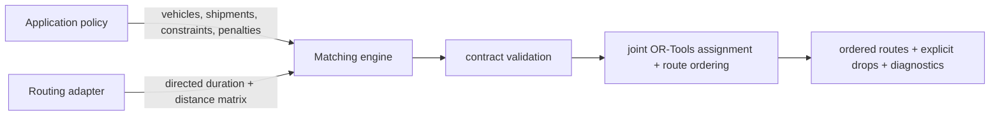

# Carpool Matching Engine

A provider-neutral Python core for jointly assigning passenger shipments to vehicles and ordering
their pickup and delivery stops. It is a technical extraction of matching work developed for
[RideAssign](https://www.ride-assign.com), with application policy and routing-provider operations
kept outside the package.

> **Status:** pre-public release candidate. The code is licensed under Apache-2.0, while repository
> visibility remains private until the ownership and release-readiness checklist is approved.

## At a glance



The core solves vehicle assignment and stop ordering in one model. That distinction matters when a
locally attractive assignment can consume the only vehicle eligible for a later passenger. The
fixed [greedy eligibility trap](docs/greedy-vs-joint.md) shows this failure mode step by step.

## What it demonstrates

- the application compiles product and business policy into explicit vehicles, shipments,
  constraints, penalties, and a bounded search portfolio
- a provider adapter supplies one complete directed duration-and-distance matrix for every problem
  location
- the core validates those contracts before optimization
- OR-Tools jointly chooses vehicle assignment and pickup/delivery ordering
- capacity, pickup-before-delivery, vehicle eligibility, time windows, stop limits, route-duration
  limits, required shipments, and optional-shipment drop penalties are represented explicitly
- the result contains ordered routes, explicit dropped shipment ids, an objective value, total
  runtime, and diagnostics for every search attempt

The package contains no database access, web framework, authentication, billing, analytics,
application configuration, or routing-vendor SDK. See [the architecture](docs/architecture.md) and
[algorithm boundaries](docs/algorithm.md).

## Correctness boundary

The engine runs a caller-defined sequence of time-bounded OR-Tools search attempts and returns the
best feasible objective they find. A feasible result satisfies the modeled constraints, but a
time-bounded search result is **not proof of global optimality**. The objective also reflects the
policy compiled into costs and penalties; it is not a universal measure of carpool quality.

## Development

Requirements: Python 3.12 through 3.14.

```bash
python3.12 -m venv .venv
.venv/bin/python -m pip install -e ".[dev]"
make check
```

`make check` runs Ruff, strict mypy, deterministic tests, coverage checks, and the package build.

## Run the example

After installing the development environment, run:

```bash
make example
```

The self-contained example uses invented coordinates and the synthetic straight-line matrix
provider. It prints each vehicle's ordered route, served shipments, explicit drops, and objective.
Production applications provide their own road-network matrix adapter.

## API sketch

```python
from carpool_matching_engine import (
    Coordinate,
    Location,
    MatchingProblem,
    SearchConfig,
    Shipment,
    Vehicle,
    solve_with_provider,
)

locations = (
    Location("driver-start", Coordinate(48.120, 11.540)),
    Location("pickup", Coordinate(48.130, 11.560)),
    Location("destination", Coordinate(48.140, 11.580)),
)
problem = MatchingProblem(
    locations=locations,
    vehicles=(
        Vehicle(
            id="vehicle-1",
            start_location_id="driver-start",
            end_location_id="destination",
            capacity=3,
        ),
    ),
    shipments=(
        Shipment(
            id="shipment-1",
            pickup_location_id="pickup",
            delivery_location_id="destination",
            required=False,
            drop_penalty=100_000,
        ),
    ),
    time_horizon_seconds=7_200,
)

# Implement MatrixProvider with a production routing adapter. This synthetic helper is only for
# examples and tests and must not be presented as a road-network router.
from carpool_matching_engine.testing import StraightLineMatrixProvider

result = solve_with_provider(
    problem,
    StraightLineMatrixProvider(),
    SearchConfig.balanced(seconds_per_attempt=2),
)
```

`result.routes` contains each vehicle's ordered start, pickup, delivery, and end stops.
`result.dropped_shipment_ids` makes non-service explicit. `result.diagnostics` exposes the selected
objective, total runtime, and solved status, objective, and runtime for each configured attempt.

## Synthetic benchmark

Run the fixed synthetic comparison from the repository root:

```bash
.venv/bin/python -m benchmarks.run
```

It compares the OR-Tools engine with a deterministic greedy insertion baseline and reports
coverage, objective, matrix travel cost, and elapsed time. The baseline intentionally supports only
the benchmark's narrow shared-destination subset, and elapsed times are single-run observations,
not performance claims. Methodology and limitations are documented in
[docs/benchmarking.md](docs/benchmarking.md).

The committed eligibility-trap scenario makes the architectural difference observable: joint
optimization serves both shipments, while the greedy baseline commits the flexible shipment to the
only vehicle eligible for the restricted shipment and serves one of two.

Observed with the pinned dependencies; objective and travel columns are deterministic for these
fixtures, while elapsed time is intentionally omitted here:

| Scenario | Solver | Served | Objective | Matrix travel (s) |
| --- | --- | ---: | ---: | ---: |
| balanced-clusters | OR-Tools | 6/6 | 1,424 | 1,424 |
| balanced-clusters | greedy | 6/6 | 1,424 | 1,424 |
| capacity-pressure | OR-Tools | 4/6 | 201,232 | 1,232 |
| capacity-pressure | greedy | 4/6 | 201,232 | 1,232 |
| vehicle-eligibility | OR-Tools | 4/4 | 1,508 | 1,508 |
| vehicle-eligibility | greedy | 4/4 | 1,508 | 1,508 |
| greedy-eligibility-trap | OR-Tools | **2/2** | **2,462** | 2,462 |
| greedy-eligibility-trap | greedy | **1/2** | **101,422** | 1,422 |

These four fixtures demonstrate behavior, not general superiority. For repeated observations on
larger seeded synthetic problems, run:

```bash
.venv/bin/python -m benchmarks.scale \
  --repetitions 5 \
  --seconds-per-run 1 \
  --hardware-label "your CPU or machine"
```

The scale suite reports the served range, best and median objective, and median/p95 in-process
solver runtime for 4 vehicles/16 shipments, 8/32, and 16/64. See
[scale benchmarking](docs/scale-benchmarking.md) for recorded results and limitations.

## Data and IP boundary

All committed examples, tests, and benchmarks must be synthetic. Do not add RideAssign customer
data, production coordinates, routing-provider payloads copied from production, credentials,
database schemas, private prompts, or application-specific policy code.

The exact release state, completed scans, and remaining ownership decision are tracked in the
[public-release checklist](docs/public-release-checklist.md). Repository visibility must not change
until that checklist's blocking approval is recorded.

## License

Licensed under the [Apache License 2.0](LICENSE). Contributions are accepted under the same license.
