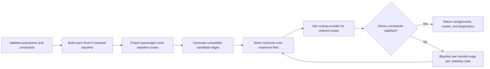

# Carpool Matching Engine

A provider-neutral, constraint-aware passenger-to-driver assignment engine extracted from the
production matching work behind RideAssign.

> **Status:** private technical extraction. The package is intentionally marked `private` and is
> currently all-rights-reserved while the future open-source license and public-release scope are
> reviewed.

## What it demonstrates

- pinned passengers reserve real driver capacity before optional matching
- group-compatibility policies are applied before candidate scoring
- passenger/driver assignment uses minimum-cost maximum flow
- candidate costs combine a route-projection detour lower bound, pickup distance, and route progress
- a routing provider validates the real ordered route after assignment
- over-limit routes are repaired by blacklisting costly passenger/driver edges and solving again
- full-coverage mode fails explicitly when every passenger cannot be placed
- routing responses and routing-call budgets are strict contracts, with no hidden fallback

The engine contains no database access, web framework, authentication, billing, analytics, or
vendor SDK. Applications provide a `RoutingProvider` implementation and persist the result however
they choose.

## Algorithm



This is a hybrid optimization strategy, not a claim of globally optimal vehicle routing. The flow
stage optimizes the assignment surrogate exactly; route ordering and repair depend on the supplied
routing provider and the bounded repair process. See [docs/algorithm.md](docs/algorithm.md).

## Development

Requirements: Node.js 22.22 or newer and pnpm 11.20 or newer within pnpm 11.

```bash
pnpm install
pnpm check
pnpm demo
```

`pnpm check` runs formatting/lint checks, strict TypeScript, deterministic tests, and the package
build.

## API sketch

```ts
import { matchCarpools, type MatchingProblem, type RoutingProvider } from "carpool-matching-engine";

const routingProvider: RoutingProvider = yourRoutingAdapter;
const problem: MatchingProblem = {
  destination: { latitude: 48.1372, longitude: 11.5756 },
  drivers: [
    {
      id: "driver-1",
      origin: { latitude: 48.125, longitude: 11.55 },
      capacity: 3,
      groupId: null,
    },
  ],
  passengers: [
    {
      id: "passenger-1",
      origin: { latitude: 48.13, longitude: 11.56 },
      groupId: null,
      pinnedDriverId: null,
    },
  ],
  groupPolicy: "same-group",
  mode: {
    kind: "natural-carpool",
    maxDetourSeconds: 900,
    maxPickupDistanceKm: 3,
  },
  limits: { maxRepairRounds: 20, maxRoutingCalls: 500 },
};

const result = await matchCarpools(problem, routingProvider);
```

`carpool-matching-engine/testing` exports a deterministic straight-line simulation provider for
examples and tests. It evaluates every stop permutation, rejects more than eight stops, and must not
be presented as a road-network router.

## Routing-provider contract

The provider receives an origin, destination, and unordered passenger stops. It must return:

- total route duration
- route geometry
- one duration per geometry segment, summing exactly to total duration
- every requested stop id exactly once, in visit order

Malformed responses throw `MatchingEngineError` with `INVALID_ROUTING_RESPONSE`. The engine does not
guess missing geometry, ordering, or durations.

## Data and IP boundary

All committed examples and tests are synthetic. Do not add RideAssign customer data, production
coordinates, provider payloads, credentials, database schemas, or application-specific code.

Before making this repository public:

1. confirm company ownership and approval for the extracted algorithm
2. choose and add the intended open-source license
3. complete dependency/license and secret-history scans
4. add public contribution and conduct policies
5. publish reproducible benchmarks against a documented baseline
