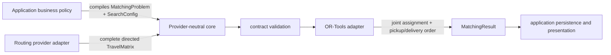

# Architecture

## Boundary map

## Application-owned policy compilation

The application owns product meaning. It resolves users and stored data, applies authorization and
business rules, chooses location ids, maps eligibility to `allowed_vehicle_ids`, marks shipments
required or optional, assigns drop and timing penalties, and selects the bounded search portfolio.
The engine does not import those concepts or maintain a second policy implementation.

This separation makes policy changes explicit and testable at the application boundary while
keeping the optimization package reusable.

## Provider-owned travel data

A `MatrixProvider` receives the problem's locations and returns one `TravelMatrix`. Both duration
and distance tables are complete directed matrices indexed by exactly those location ids. Direction
matters: travel from A to B may differ from B to A.

Production adapters, routing-vendor SDKs, request batching, caching, retries, credentials, and
provider observability belong outside this repository. The core rejects incomplete or malformed
matrices and does not estimate or silently replace missing values.

## Core domain and optimization adapter

Frozen dataclasses define the public problem, matrix, search, result, diagnostic, and error
contracts. Validation and orchestration operate on those provider-neutral types. OR-Tools-specific
model construction and extraction stay behind the optimization adapter.

The adapter creates one pickup-and-delivery routing model, so vehicle assignment and stop order are
optimized together rather than in separate assignment and route-repair phases. The model combines
directed travel duration, service duration, capacity, precedence, eligibility, time, stop-count,
route-duration, required-service, drop-penalty, and soft-time constraints.

## Result and failure contract

`MatchingResult` contains:

- one ordered `SolvedRoute` per vehicle, including explicit pickup and delivery stops
- sorted `dropped_shipment_ids`
- the selected objective and total elapsed time
- one diagnostic for each configured search attempt

Expected contract failures use stable `MatchingEngineError` codes. Invalid input and matrices fail
before search. Exhausting every bounded attempt without a feasible solution raises `NO_SOLUTION`.
There is no hidden fallback solver.

## Deployment boundary

The package is a library, not a service. Database access, HTTP endpoints, authentication,
persistence, application logging, provider clients, and production configuration remain in the
integrating application. This repository stores synthetic fixtures only and is distributed under
the Apache License 2.0 after the documented public-release gate is approved.
