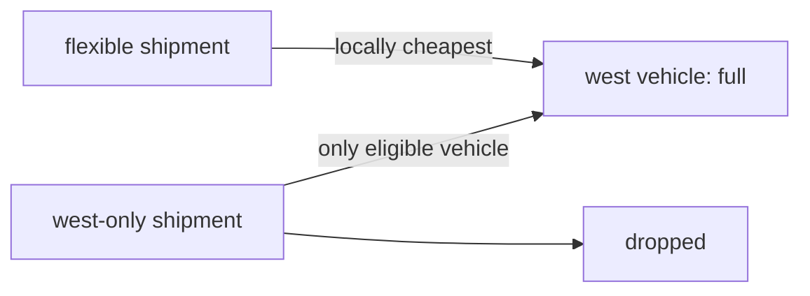
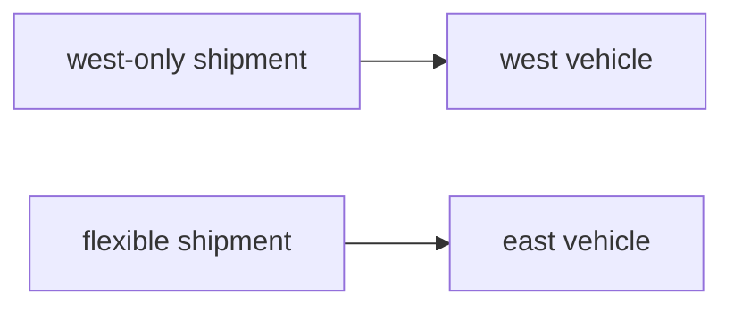

# Why assignment and route ordering belong in one model

Matching riders to drivers and then repairing each route sounds modular, but the first phase can
consume an option that the second phase cannot recover. The committed `greedy-eligibility-trap`
fixture reduces that risk to two vehicles and two shipments.

## The setup

- `vehicle-west` and `vehicle-east` each have one seat.
- `shipment-flexible` may use either vehicle and is locally cheapest for `vehicle-west`.
- `shipment-west-only` may use only `vehicle-west`.
- both shipments carry the same explicit drop penalty.

## The greedy commitment

The deterministic baseline evaluates the cheapest immediate insertion. It assigns the flexible
shipment to `vehicle-west`, because that produces the smallest local travel increase. The west-only
shipment is considered later, but its only eligible seat is already occupied. The baseline does not
revisit its earlier decision, so it serves one of two shipments and pays one drop penalty.

## The joint decision

The OR-Tools model represents shipment-to-vehicle assignment and pickup/delivery order together.
It can compare complete feasible plans rather than irreversible single insertions. It places the
restricted shipment in `vehicle-west` and the flexible shipment in `vehicle-east`, serving both.

| Solver | Served | Objective | What happened |
| --- | ---: | ---: | --- |
| Joint OR-Tools model | 2/2 | 2,462 | Preserved the constrained assignment |
| Greedy insertion | 1/2 | 101,422 | Committed the flexible shipment first |

The result proves a property of this fixed synthetic case, not universal superiority. The greedy
baseline is intentionally myopic, and the OR-Tools search is wall-clock bounded rather than a
certificate of global optimality. The engineering lesson is narrower: when assignment constraints
and route costs interact, optimizing them in separate irreversible phases can discard feasible
global plans.
